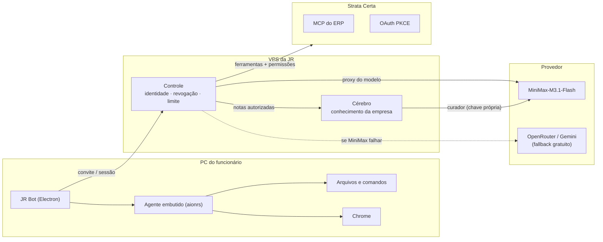

# Guia interno do JR Bot

Guia da edição corporativa **JR Santa Fé** para administradores e funcionários. Explica como o bot executa, como a empresa protege o acesso e o conhecimento, e como o sistema se mantém rápido e barato.

> Documentação técnica de validação e operação: [`docs/pilot/`](../pilot). Código dos serviços: [`services/control/`](../../services/control) e [`services/brain/`](../../services/brain).

## O sistema em uma imagem



Cada peça executa em um lugar diferente, de propósito:

| Peça         | Onde roda         | O que faz                                                                 | Não faz                             |
| ------------ | ----------------- | ------------------------------------------------------------------------- | ----------------------------------- |
| **JR Bot**   | PC do funcionário | Executa arquivos, comandos, navegação e documentos                        | Não guarda a chave do modelo        |
| **Controle** | VPS da JR         | Valida identidade, emite convite, revoga, limita e faz o proxy do MiniMax | Não recebe conversas nem documentos |
| **Cérebro**  | VPS da JR         | Recebe só o conhecimento explicitamente autorizado e o torna pesquisável  | Não fala com o app diretamente      |
| **Strata**   | ERP da empresa    | Fornece permissões reais e ferramentas do MCP do ERP                      | Não é criado pelo JR                |

## O fluxo de uma conversa

```mermaid
sequenceDiagram
    participant F as Funcionário
    participant A as JR Bot (PC)
    participant C as Controle (VPS)
    participant M as MiniMax
    participant B as Cérebro
    participant S as Strata

    F->>A: envia pedido no bot
    A->>C: valida sessão (a cada chamada)
    C-->>A: sessão válida?
    A->>C: encaminha o pedido
    C->>M: chama o modelo (sem expor a chave)
    M-->>C: resposta (streaming)
    C-->>A: resposta
    A-->>F: exibe

    Note over A,B: quando o funcionário compartilha algo:
    F->>A: "compartilha este trecho"
    A->>C: proposta de nota (trecho autorizado)
    C->>B: cria rascunho privado
    B->>M: curador gera proposta
    F->>A: revisa e consente
    A->>C->>B: consentimento assinado
    B-->>C: nota publicada / pendente
```

## Guias

- **[Execução](execucao.md)** — como o bot lê arquivos, roda comandos, navega no Chrome e gera documentos, e como o funcionário aprova cada ação.
- **[Guarda](guarda.md)** — convite, revogação, limites de uso e o caminho de consentimento do conhecimento.
- **[Otimização](otimizacao.md)** — fallback gratuito, compactação de contexto longo, limites de transporte e medição de consumo.
- **[Comparativo OpenBot](comparativo-openbot.md)** — o que o app de referência OpenBot faz e o que falta no JR Bot.
- **[Inventário do OpenBot](openbot-inventario.md)** — mapeamento completo feature por feature (e o alerta de licença).
- **[Spec: Rotinas com Webhooks](spec-rotinas-webhooks.md)** — automação disparada por eventos externos (a primeira lacuna a implementar).

## Começando

Desenvolvimento (Node.js 24 + Bun):

```sh
bun install
bun run package
JR_CONTROL_URL=https://jrsantafe.stratacerta.com.br/bot bun run start:jr
```

Sem `JR_CONTROL_URL`, o comando `start:jr` entra no piloto de desenvolvimento local, que não é a distribuição dos funcionários. O aplicativo empacotado usa o controle corporativo por padrão.
