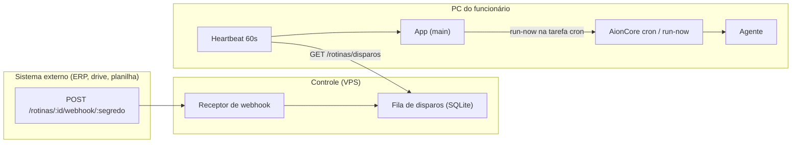

# Spec + Plano: Rotinas com Webhooks

**Branch**: `feat/jr-rotinas-webhooks` · **Status**: Rascunho · **Data**: 2026-11-06
**Referência**: OpenBot (WorkflowsPage + RoutineWebhookEndpoint). Guia base: [`../README.md`](README.md).

---

## 1. Visão e problema

Hoje o JR Bot já executa **tarefas agendadas** (cron do AionCore): expressão cron, intervalo e execução única, ligadas a uma conversa de bot. O que falta — e que o OpenBot tem — é poder **disparar o bot por um evento externo**: um webhook.

O funcionário quer, por exemplo:

- "Quando chegar um pedido novo no ERP, rodar a análise X."
- "Quando uma planilha for atualizada no drive, gerar o relatório Y."

Isso não existe hoje. O objetivo desta feature é criar **rotinas** (um nome + instruções + gatilhos) que podem ser disparadas **por agendamento** (já existe) **e por webhook** (novo).

## 2. Ponto de partida (o que já existe)

| Peça       | Onde                                        | O que faz                                                              |
| ---------- | ------------------------------------------- | ---------------------------------------------------------------------- |
| Cron       | Backend AionCore (`/api/cron/*`)            | Agenda e executa tarefas (cron/intervalo/única), `run-now`, keep-awake |
| UI de cron | `packages/desktop/src/renderer/pages/cron/` | Criar/editar/pausar/excluir tarefas                                    |
| Heartbeat  | `process/services/jr/auth.ts`               | Consulta `/auth/session` a cada 60s (`JR_SESSION_CHECK_INTERVAL_MS`)   |
| Controle   | `services/control/` (VPS)                   | Identidade, revogação, proxy do modelo, SQLite                         |

A feature **não reinventa o cron**. Ela adiciona uma camada fina por cima: uma **rotina** = uma tarefa cron existente + um registro de webhook opcional no controle.

## 3. Escopo

**v1 (nesta spec):**

- Criar, listar e desativar **rotinas** (nome + instruções + agendamento + webhook opcional).
- Cada rotina gera uma **URL de webhook com segredo** que sistemas externos chamam via `POST`.
- O disparo do webhook entrega a execução ao PC do funcionário (fila quando offline).
- Histórico simples de execuções por rotina.

**Fora do v1:**

- Workflows multi-etapa com condições/ramificações.
- Gatilhos que não sejam agendamento ou webhook (ex.: e-mail, cron de outro sistema).
- Aprovação automática de ferramentas (segue a política atual de confirmação manual).

## 4. Cenários de uso

### História principal

> Como funcionário, eu quero criar uma rotina com um endereço de webhook, para que um sistema externo dispare o meu bot sem eu estar no computador.

### Cenários de aceite

1. **Dado** um bot criado, **quando** o funcionário cria uma rotina "Análise de pedido" e ativa o webhook, **então** o app mostra uma URL única com segredo para copiar.
2. **Dado** uma rotina com webhook ativo, **quando** um sistema externo faz `POST` nessa URL, **então** o bot executa a instrução da rotina na conversa vinculada.
3. **Dado** o PC desligado no momento do `POST`, **quando** o funcionário abre o app depois, **então** a execução pendente é entregue (se dentro do prazo) ou descartada (se expirada).
4. **Dado** um webhook chamado com o segredo errado, **então** o controle responde 404 sem registrar execução.
5. **Dado** uma rotina desativada, **quando** o webhook é chamado, **então** não há execução.

### Casos de borda

- Webhook dispara em sequência rápida (rate limit por rotina).
- Payload grande demais (limite de tamanho → 413).
- Funcionário revogado no momento da entrega (execução é descartada).
- Rotina vinculada a uma conversa que não existe mais (erro claro, sem crash).

## 5. Requisitos funcionais

- **FR-001**: O funcionário DEVE poder criar uma rotina com nome, instruções em linguagem natural, agendamento e webhook opcional.
- **FR-002**: O sistema DEVE gerar uma URL de webhook com segredo de alta entropia, única por rotina.
- **FR-003**: O sistema DEVE aceitar `POST` na URL de webhook e enfileirar um disparo para o funcionário dono da rotina.
- **FR-004**: O aplicativo DEVE coletar disparos pendentes e executar a instrução na conversa vinculada.
- **FR-005**: O sistema DEVE descartar disparos expirados (TTL) e reportar o descarte.
- **FR-006**: O payload do webhook NUNCA DEVE ser tratado como instrução; é contexto/dados da execução.
- **FR-007**: O sistema DEVE registrar, por rotina, o histórico de execuções (sucesso, falha, expirado).
- **FR-008**: Um funcionário NÃO DEVE poder ver ou disparar a rotina de outro funcionário.

## 6. Entidades

- **Rotina**: id, funcionário, nome, instruções, id da tarefa cron vinculada, habilitada, segredo (hash), criada em, última execução.
- **Disparo (trigger)**: id, rotina, hash do payload, criado em, entregue em, expirado em.
- **Execução**: rotina, disparo (ou agendamento), iniciada em, status (sucesso/falha/expirada).

## 7. Arquitetura

**Quem faz o quê** (respeitando os limites de processo):

| Camada             | Responsabilidade                                                              |
| ------------------ | ----------------------------------------------------------------------------- |
| Controle (VPS)     | Receber `POST`, validar segredo, enfileirar, expirar, rate-limit              |
| App (main process) | Coletar disparos no heartbeat, chamar o run-now no AionCore, reportar entrega |
| AionCore           | Executar a tarefa na conversa (igual ao cron de hoje)                         |
| Renderer           | UI de rotinas (lista, criar, copiar URL)                                      |

## 8. Contrato HTTP (novo, no controle)

| Método e caminho                             | Entrada/Resposta                                                                                       |
| -------------------------------------------- | ------------------------------------------------------------------------------------------------------ |
| `POST /routines`                             | Entrada `{name, instructions, schedule, conversationId}`. Resposta `201 {id, webhookUrl}`.             |
| `GET /routines`                              | `{routines:[{id,name,enabled,lastRunAt}]}`                                                             |
| `POST /routines/:id/enable` / `/disable`     | Liga/desliga o webhook                                                                                 |
| `POST /routines/:id/webhook/:secret`         | Público. Corpo JSON ≤ 64 KiB. `202` se enfileirado, `404` se segredo inválido, `429` se excedeu limite |
| `GET /routines/disparos`                     | Autenticado. Devolve disparos pendentes do funcionário                                                 |
| `POST /routines/:id/disparos/:triggerId/ack` | Autenticado. Confirma entrega                                                                          |

## 9. Segurança

- Segredo de webhook com **alta entropia** (256 bits), armazenado só como hash.
- Payload **limitado** (64 KiB) e **nunca vira instrução** (FR-006).
- Rate limit por rotina (ex.: 30/hora, alinhado ao padrão do OpenBot).
- Webhook não autentica por sessão: a URL com segredo é a credencial (padrão de webhooks).
- Revogação do funcionário cancela a entrega pendente.

## 10. Tratamento offline

- O agente roda no PC; webhook só executa com o PC ligado e o app aberto.
- Disparo fica na fila com **TTL (24h)**. Entregue no próximo heartbeat; expira se não houver app online.
- O expirado é registrado no histórico da rotina (FR-005).

## 11. i18n

Novas chaves em `locales/pt-BR` (módulo `routine`): `routine.create`, `routine.webhookUrl`, `routine.copy`, `routine.history`, `routine.expired`, etc. Seguir o fluxo do skill `i18n`.

## 12. Testes

- **Controle**: unit (`tests/unit/jr/control/`): validação de segredo, rate limit, TTL, isolamento por funcionário, revogação cancela entrega.
- **App**: unit para o coletor de disparos e para o parser de payload (sanitização).
- **Integração**: webhook → fila → heartbeat → run-now (com AionCore fake).

## 13. Decisões em aberto

- [DECISÃO] O payload do webhook entra como **mensagem de contexto** na conversa? Qual o formato (JSON bruto vs. texto formatado)?
- [DECISÃO] Limite de rotinas por funcionário (sugestão: 10)?
- [DECISÃO] TTL fixo em 24h ou configurável por rotina?

## 14. Plano de implementação (fases)

1. **Controle**: tabelas `routines`/`routine_triggers` + rotas (seção 8) + testes unit.
2. **Contrato**: tipos compartilhados e testes de contrato.
3. **App (main)**: coletor de disparos no heartbeat + chamada run-now + ack.
4. **App (renderer)**: tela de rotinas (lista/criar/copiar URL) + i18n.
5. **Integração + validação** com o fluxo completo (webhook até execução no bot).

---

_Referências de convenção: `.specify/templates/spec-template.md`, `.specify/templates/plan-template.md`, skill `architecture`, skill `testing`, skill `i18n`._
