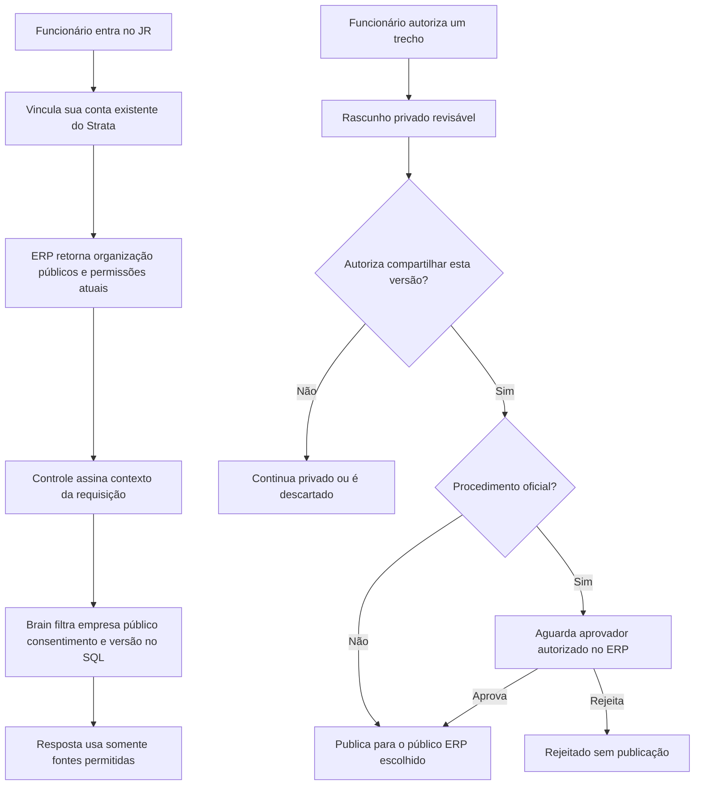

# JR: vínculo Strata, Brain e aprendizado

Esta entrega reúne o vínculo individual com o Strata Certa, o conhecimento compartilhado com permissões do ERP, o aprendizado privado por eventos reais e a continuidade das sessões do navegador.

O servidor JR Control, o Brain e o catálogo MCP foram ativados em produção, com autorização, em 6 de novembro de 2026. O pacote macOS arm64 foi instalado e validado localmente, incluindo **Conectar aplicativos → Strata Certa** com a conta já vinculada. As demais instalações ainda dependem da distribuição de uma atualização. Atualizar o servidor ou o GitHub não atualiza o aplicativo instalado.

## Onde revisar

- JR: código desta branch, [controle e OAuth](jr-control.md) e [consentimento e aprendizado](jr-brain-consent.md).
- ERP: [PR #148](https://github.com/lucaszocaratto15/erp-stratacerta/pull/148), `server/mcp/`, política de acesso e leitores canônicos.
- Inventários, patches históricos e evidências de produção ficam em `docs/integrations/jr/` no repositório privado do ERP. Credenciais e relatórios de negócio ficam fora dos dois repositórios.

## Atualização sem perda de histórico

A atualização preserva os bots históricos e suas conversas. Antes de carregar a lista, o processo nativo vincula os registros antigos sem proprietário à conta autenticada já vinculada ao aparelho. IDs, instruções, aprendizados, aparência e referências de conversa permanecem iguais; registros de outra conta não são adotados. Todos os bots antigos desse funcionário continuam acessíveis. Novos perfis permitem um assistente, e quem já tem um não recebe a opção de criar outro. Falha na migração exibe erro, sem apresentar o perfil como vazio.

A validação do pacote macOS comparou o banco com o backup, reabriu uma conversa original e conferiu o vínculo Strata na interface. Bots, conversas e mensagens permaneceram iguais; a migração acrescentou somente o proprietário aos registros de workspace. O backup completo anterior à instalação foi mantido.

## Brain com autorização do Strata

| Ação                                               | Permissão efetiva no ERP                                      |
| -------------------------------------------------- | ------------------------------------------------------------- |
| Ler                                                | `conhecimento.visualizar`                                     |
| Publicar nota                                      | Leitura e `conhecimento.incluir`                              |
| Propor nova versão de uma nota própria             | Leitura e `conhecimento.alterar`                              |
| Retirar uma nota própria                           | Leitura e `conhecimento.excluir`                              |
| Aprovar, rejeitar ou reativar procedimento oficial | Leitura e `conhecimento-procedimentos.visualizar` + `alterar` |
| Acessar público de um módulo                       | Também exige `visualizar` no módulo correspondente            |

As cinco empresas do Grupo JR usam o vínculo de grupo e as permissões da empresa principal, exatamente como o ERP. A seleção de empresa é o filtro padrão das ferramentas operacionais; o MCP aceita outra empresa do mesmo escopo sem trocar a seleção. O Brain faz uma única busca SQL na base compartilhada do grupo. Filtra empresas e módulos autorizados antes de materializar candidatos, aplica um ranking/limite global e mantém a empresa como origem. Não há consultas separadas por empresa nem migração de notas.

O ERP é a única origem desses poderes. Nenhuma concessão é inserida automaticamente, e ser administrador JR não concede acesso. A migração aditiva amplia o catálogo mantendo funções e exceções existentes. A busca, o histórico e a gestão excluem registros legados sem proveniência/consentimento ERP comprovados. Troca de conta, empresa ou sessão invalida a interface e respostas em andamento.

O controle também exige que uma resposta bem-sucedida confirme o protocolo de autorização ERP e a organização esperada. Uma versão antiga do Brain que ignore a nova política não libera conteúdo silenciosamente.

Uma revisão vinculada à nota conserva seu público original. Texto livre escolhido manualmente exige revisão humana da fonte: o sistema não comprova a origem nem herda automaticamente a permissão de um documento colado.

## Aprendizado por eventos reais

O funcionário precisa autorizar as novas fontes explicitamente. As fontes iniciais são consultas verificadas de equipamentos, ordens de manutenção, obras e aprovações de compras, além de downloads concluídos no navegador integrado. A captura não armazena argumentos, resultados, nomes de arquivos, caminhos, URLs, documentos ou credenciais. Os eventos ficam cifrados e separados por funcionário.

Uma consulta bem-sucedida comprova a consulta; um download concluído comprova a obtenção do arquivo. Eles não comprovam que uma obrigação foi cumprida ou que o documento está correto. Sequências geram candidatas privadas, que só entram no mapa mensal após revisão. Pausa, revogação, logout e mudança de funcionário invalidam operações pendentes. A retenção antiga de amostras brutas continua em 48 horas.

## Sessões do navegador integrado

O navegador integrado usa Chromium local do Electron, sem uma VM por assistente ou janela externa. A página permanece montada ao ocultar o painel e ao trocar de tela ou projeto. Somente a sessão do projeto/aba atual fica visível e interativa. Durante pesquisa, gravação, login seguro ou controle humano, outra página não assume o alvo CDP da tarefa. O limite global de dez sessões recusa uma nova sessão em vez de descartar páginas de outro projeto. Popups precisam corresponder ao guest nativo do funcionário e do projeto atuais; uma página estacionada ou encerrada não abre abas no projeto novo.

CAPTCHA e desafios humanos usam a transferência de controle na mesma página e sessão. Senhas e códigos passam pelo formulário seguro do chat. O conector opcional `chrome-jr`, que inicia Chrome externo, continua sendo um caminho separado; esta mudança mantém o navegador integrado como caminho canônico e não adiciona uma ponte de controle humano ao Chrome externo.

Sair do JR ou trocar de funcionário encerra as sessões integradas e limpa cookies, armazenamento e cache antes de permitir um novo navegador. Se a limpeza falhar, o novo navegador permanece bloqueado. Reiniciar o aplicativo com o mesmo funcionário não aciona essa limpeza; continuam valendo as expirações de sessão dos próprios sites. Os testes não executaram limpeza no navegador real do usuário.

## Catálogo de consultas

O catálogo registra 370 leituras de 61 arquivos do backend, com os 27 módulos ERP classificados. O JR usa `erp.consultas.buscar`, `erp.consultas.descrever` e `erp.consultas.executar`, com o escopo `mcp:erp:ler`. Identidade, descoberta e consultas do catálogo dispensam selecionar uma empresa; o servidor resolve o grupo da conta vinculada. A tela de conexão informa o acesso ao grupo e não oferece seleção de empresa. Uma seleção antiga salva não restringe as consultas do catálogo.

As consultas reutilizam os leitores e cálculos das telas em transação PostgreSQL somente leitura. Descoberta, execução e revalidação da resposta aplicam as permissões atuais do ERP. O modelo não escolhe a organização e não recebe SQL livre. Mutações MCP permanecem desativadas na configuração de produção validada.

A validação real concluiu o OAuth de uma conta existente e consultou identidade, equipamentos, Brain e um relatório de combustível do grupo. As 370 rotas têm teste de entrada no leitor canônico; isso não comprova todos os resultados contra dados completos.

## Verificação e limites

Os testes usam SQLite e PostgreSQL temporários, MCP SDK e provedores isolados. Na atualização do código, a suíte JR passou em 6.261 testes Vitest, com cinco ignorados, e 334 testes Node. TypeScript e lint também passaram. As verificações completas antes do push são executadas por `just push`.

Permanecem pendentes:

1. OAuth real e consultas com uma conta de funcionário de acesso restrito; os testes de política não substituem esse login.
2. Resultados completos das 370 consultas e testes de volume.
3. Aplicativo empacotado no Windows/CRTI, layout traduzido e qualidade das respostas do modelo.
4. Comunicação completa entre assistentes. A consulta atual usa notas autorizadas, sem abrir conversas privadas de outras pessoas.

Nenhum dado real de negócio é alterado pela sincronização dos repositórios.
